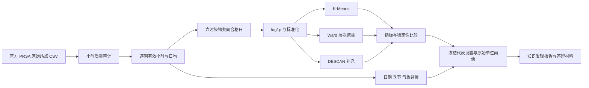

# 项目架构与模块契约

本轮已经创建下列目录。标注“待实现”的程序模块和 Notebook 只在此定义职责，没有创建假实现；已实现脚本只有来源核验与骨架核验。目录中的 README/.gitkeep 用于保留用途或空输出位置。

## 目录

```text
AISC5030-Group-Project/
  AGENTS.md                              agent 总规则
  README.md                              项目导航与真实状态
  requirements.txt                       建议依赖范围
  .agents/skills/scientific-clustering/
    SKILL.md                             项目执行技能
    agents/openai.yaml                   技能界面元数据
  Week 5/                                用户课程原件，保留
  docs/                                  方案、协议、架构、交接
  references/sources.md                   课程/数据/方法引用
  configs/project.yaml                   实验参数唯一配置源
  data/
    raw/                                 官方 ZIP 与固定站点 CSV
    interim/                             小时清洗副本，待生成
    processed/                           日表、覆盖率、特征，待生成
    metadata/                            已有 source_preflight.json
  src/air_quality_clustering/             可复用研究逻辑，待实现
  scripts/                               已有 verify_source.py、verify_scaffold.py
  notebooks/                             EDA、方法、知识解释，待实现
  tests/                                 数据/算法边界测试，待实现
  results/
    runs/                                每次运行的权威完整产物
    figures/                             最终选用图副本与来源清单
    tables/                              最终选用表副本与来源清单
    labels/                              最终选用标签副本与来源清单
    stability/                           最终选用稳定性副本与来源清单
  artifacts/                             预处理参数、PCA、linkage 等模型状态
  logs/                                  控制台与阶段日志
  reports/
    templates/final_report.md             写作模板
    final/                               最终报告，待生成
  presentations/storyboard.md             答辩结构建议
```

`results/runs/<run_id>/` 是结果的权威位置。顶层 results 子目录只是为最终报告选图选表的便利导出，不重复计算，不覆盖不同运行；复制时附 `selection_manifest.json` 指向原运行与哈希。

## 数据流



背景信息在画像阶段才加入，不回流到主聚类输入。PCA 从 E 产生展示坐标，算法标签仍来自六维 E。

## 源码模块，均待实现

| 模块 | 主要输入/输出 | 必须保留的约束 |
| --- | --- | --- |
| `config.py` | YAML -> 校验后的参数对象与 hash | feature 列精确六列；task 为 unsupervised_clustering |
| `data.py` | 原始 CSV -> 小时清洗表、完整日历覆盖率、日表 | raw 只读；时区与阈值明确 |
| `features.py` | 原始日表 -> X、日期、缩放器参数 | 不接受背景列为默认特征；log 与 raw 分支分开 |
| `clustering.py` | X+方法设置 -> 标签、拟合状态、linkage | Ward 树与切分一致；DBSCAN -1 保留 |
| `evaluation.py` | X+标签 -> 指标、n_scored、无效原因 | 噪声过滤；退化设置不伪造分数 |
| `stability.py` | 主日表+参考标签 -> 共同日期 ARI 与清单 | 日历七日块；无放回；重新拟合预处理 |
| `discovery.py` | 原始日均+标签+背景 -> 画像、列联、季节表 | date 一对一连接；不生成因果或等级标签 |
| `plots.py` | 已有表与坐标 -> 统一图形 | 同一 PCA 坐标；单位、n、方法与参数完整 |
| `provenance.py` | 源码/数据/配置 -> manifest 与版本记录 | 未提交源码也有 hash；新运行不覆盖旧结果 |

使用朴素函数、pandas DataFrame 与 NumPy 数组足够。无需数据库、Web 服务、Docker 集群或复杂实验平台。可用带字段的轻量结果对象，但不为简单脚本创建多层框架。

## 命令入口

已实现：

- `scripts/verify_source.py`：离线官方文件核验，可选择写出指定原始 CSV，默认输出源审计 JSON；使用 Python 标准库，不训练模型。
- `scripts/verify_scaffold.py`：目录、文档、配置、技能引用及规划/未执行状态核查。

待实现：

- `scripts/run_project.py --stage <prepare|eda|cluster|stability|compare|sensitivity|export|all> --config <yaml>`：读取同一配置，分阶段执行。
- `scripts/check_results.py --run-id <id>`：验证结果契约与报告引用来源，不按预设成绩阈值强制结果好看。

`run_project.py` 应从任意工作目录解析项目根路径，输入路径相对项目根。每个阶段加载上游 manifest，校验配置与数据一致。失败阶段返回非零退出码并写原因，不能继续导出“完成”状态。

## Notebook 分工

1. `01_data_audit_and_eda.ipynb`：来源、覆盖率、清洗漏斗、特征分布与相关性。
2. `02_clustering_experiments.ipynb`：方法假设、候选参数与真实结果图，不在单元格内复制核心实现。
3. `03_comparison_and_discovery.ipynb`：代表设置、ARI、画像、背景解释、稳定性、敏感性和局限。

Notebook 顶部显示 run_id 和数据版本。支持清空输出后从头执行；不要依赖用户交互操作、隐藏状态或其他 Notebook 的内存变量。

## 单次运行权威目录

```text
results/runs/<run_id>/
  manifest.json                  状态、版本、数据/配置/源码哈希
  config_snapshot.yaml           实际运行配置
  experiments.csv                89 个基础设置及明确标识的补充记录
  selection.json                 入围、排除与代表设置依据
  labels/                        每个设置的 date+cluster 标签
  tables/                        画像、覆盖率、同 k ARI、季节构成
  figures/                       可用于报告的图
  stability/                     块 ID、日期成员、逐次 ARI、汇总
  sensitivity/                   独立表示分支和对照
  artifacts/                     缩放参数、PCA、Ward linkage
  logs/                          阶段日志与警告
```

全量 `experiments.csv` 的基础设置为 70+7+12=89 行，重复 eps 或无效设置也保留一行状态。稳定性和敏感性可以另表存储，不能混在基础候选计数中没有标记。

## 数据文件与结果连接键

日表主键 date。标签文件的主键为 `(run_id, experiment_id, date)`。候选结果主键 `(run_id, experiment_id)`。稳定性成员主键 `(run_id,candidate_id,replicate_id,date)`，如果各候选共用采样清单可只存统一 membership 并引用其 hash。任何 join 都要检查唯一性和未匹配数。

如果最终图表使用选中的运行副本，图注引用 run_id 和设置 ID；论文式文字中的数值由对应表读取或核对，避免手工复制不同实验版本造成错配。
