# Discovering Daily Air-Pollution Patterns in Beijing: An Unsupervised Comparison of K-Means, Ward and DBSCAN

**Course project report — AISC5030, Topic 3: Knowledge Discovery from Scientific Data**
Run ID: `20261124T223107Z-0c5c7f9d` · Protocol v1 (frozen before clustering) · Generated from the run's real outputs.

## Abstract

We apply three unsupervised clustering methods to 1333 eligible days (2013-03-01 to 2017-02-28) of six daily-mean pollutant concentrations (PM2.5, PM10, SO2, NO2, CO, O3; µg/m³) from the UCI Beijing multi-site air-quality dataset, station Aotizhongxin. Days enter the analysis only when every pollutant has at least 18 valid hourly observations; 128 of 1,461 calendar days are excluded and never imputed. The main representation is log1p followed by StandardScaler. All 89 base candidates (70 K-Means, 7 Ward cuts of one tree, 12 DBSCAN settings) are retained. Representative cluster counts are chosen by a frozen rule chain (minimum cluster size, silhouette shortlist, 20 temporal-block resamples with refitted preprocessing): K-Means k=2, Ward k=2. DBSCAN yields no representative under the coverage/cluster-count rules (11 of 12 settings collapse to a single cluster plus noise), indicating the data behave more like a continuous pollution gradient than separated density clusters. The two primary representatives agree with ARI=0.892; same-k agreement varies from 0.359 to 0.892, showing that cluster-count and algorithm geometry both matter. Block-stability median ARIs are 0.970 (K-Means) and 0.707 (Ward); a raw-value sensitivity branch gives ARIs of kmeans=0.392, ward=0.719 against the main representation. At the selected resolution (k=2 for both primary methods) the profiles describe a lower-load, ozone-richer day type and a higher-load, particulate- and CO-heavy day type; these are observational groupings, not causal or health-grade claims.

## 1. Introduction and research question

Topic 3 asks for knowledge discovery from scientific data without supervised labels. Our question: *do days with similar multi-pollutant signatures form reproducible, interpretable groups, and how do three clustering geometries (centroid, hierarchical, density) organise the same days differently?* We compare K-Means and Ward as primary methods and DBSCAN as a supplementary probe of the density assumption. No prediction target, no ground-truth labels, and no date/season/weather variable enters the distance.

## 2. Data and preprocessing

Source: UCI Machine Learning Repository ID 501, Beijing multi-site air-quality data (Zhang et al., 2016; UCI, 2017). Raw archive and station CSV are read-only; SHA256 hashes are recorded in the run manifest (CSV `a94fbcfc…351b`, full value in `manifest.json`). The station file contains 35,064 hourly rows over 1,461 calendar days.

Cleaning rules (docs/05): NA/empty/non-finite hours are missing; negative concentrations are invalidated and counted; zeros are kept; conflicting duplicate hours raise an error (none occurred); identical duplicates are removed (none occurred). A day is eligible iff each of the six pollutants has ≥18 valid hours; each daily value is the mean of that pollutant's own valid hours. Result: 1333 eligible days, 128 excluded (reasons per day in `excluded_days.csv`). Missingness is not uniform in time (F01), so the eligible-day sample carries a temporal selection bias that we disclose rather than correct.

Representation: `Z_j = (log1p(x_j) − mean_j)/std_j` with population standard deviation (F02 motivates the transform: right-skewed, multi-scale concentrations). Background columns (season, weather, station, identifiers) are excluded from the matrix by configuration validation.

## 3. Methods and evaluation protocol

- **E01 K-Means**: k=2…8 × seeds 100…109, n_init=20, max_iter=300, Lloyd → 70 runs.
- **E02 Ward**: one euclidean linkage tree, cut at k=2…8 → 7 partitions (not seven independent fits).
- **E03 DBSCAN**: m=5/10/20; eps = linear quantiles {0.70, 0.80, 0.90, 0.95} of the m-th nearest-neighbour distance **including the query point itself** → 12 settings.

Internal metrics (silhouette, Davies–Bouldin, Calinski–Harabasz) are computed on the same six-dimensional Z for K-Means/Ward over all 1333 days. DBSCAN metrics use only the non-noise subset (`n_scored` reported); noise (−1) is never treated as a cluster. Invalid metrics are stored as null with a reason. ARI measures partition agreement without labels and is invariant to cluster-number permutation.

Selection (frozen before looking at any interpretation): minimum cluster size max(10, ceil(0.01·n)) = 14 days; per-method silhouette shortlist within 0.02 of the eligible best; 20 temporal-block resamples (7-day blocks over the full 1,461-day calendar, 167 of 209 blocks per draw, seeds 100…119) with scaler and model refit on each subset; representative = highest median ARI, ties within 0.02 prefer smaller k. Median ARI < 0.70 flags weak stability (a project warning line, not a validity proof). Because k is chosen using these resamples, the stability figures carry exploratory selection bias and are not confidence intervals.

## 4. Exploratory analysis

F01 shows monthly valid-hour fractions and eligible-day fractions; several months fall below the 18/24 rule. F02 shows why log1p is used. F03: Spearman ρ(PM2.5, PM10)=0.91 and ρ(NO2, CO)=0.74 — correlated pollutants receive repeated weight in euclidean distance, a limitation we discuss rather than silently "fix". F04 displays daily series with excluded days left as gaps.

Missingness at both scales and the extreme-day index are tabulated in `tables/eda_hourly_missing.csv` and `tables/eda_extreme_days.csv`. The five highest daily means per pollutant are listed with the 99th-percentile threshold and were **retained**: an extreme value is only removed if the raw hours prove it erroneous, which was never the case here.

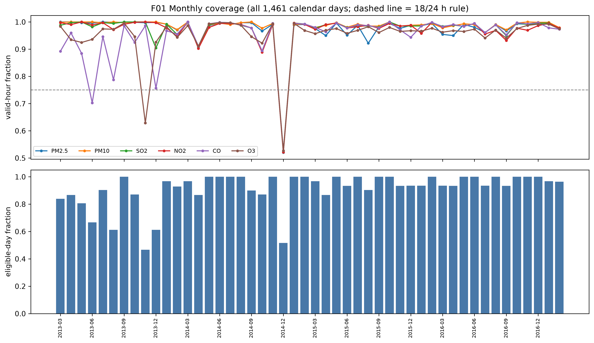
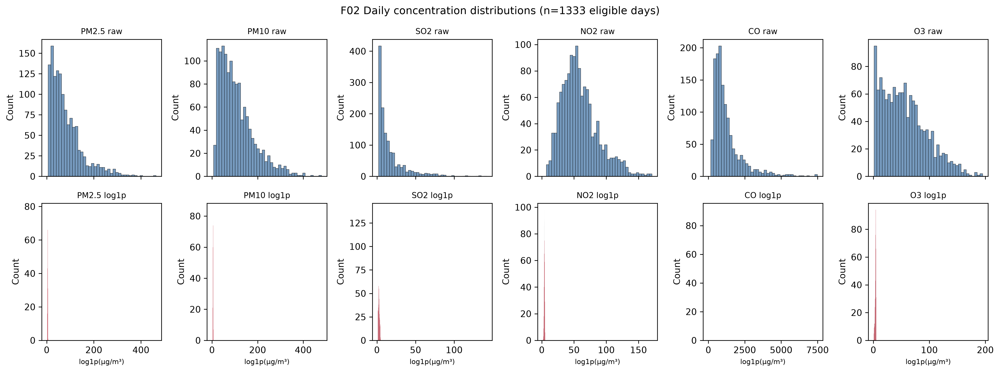
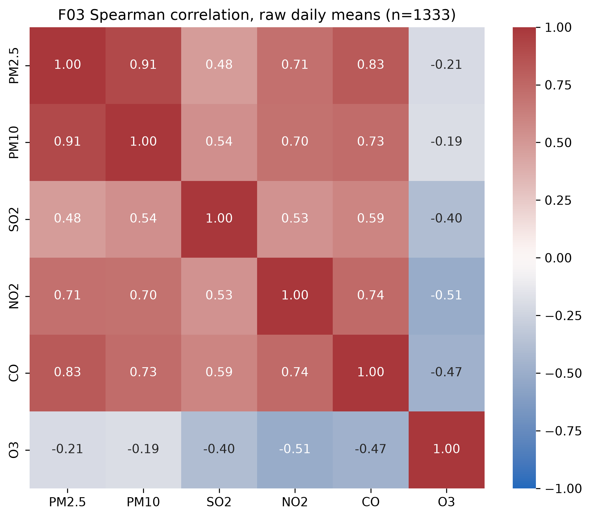
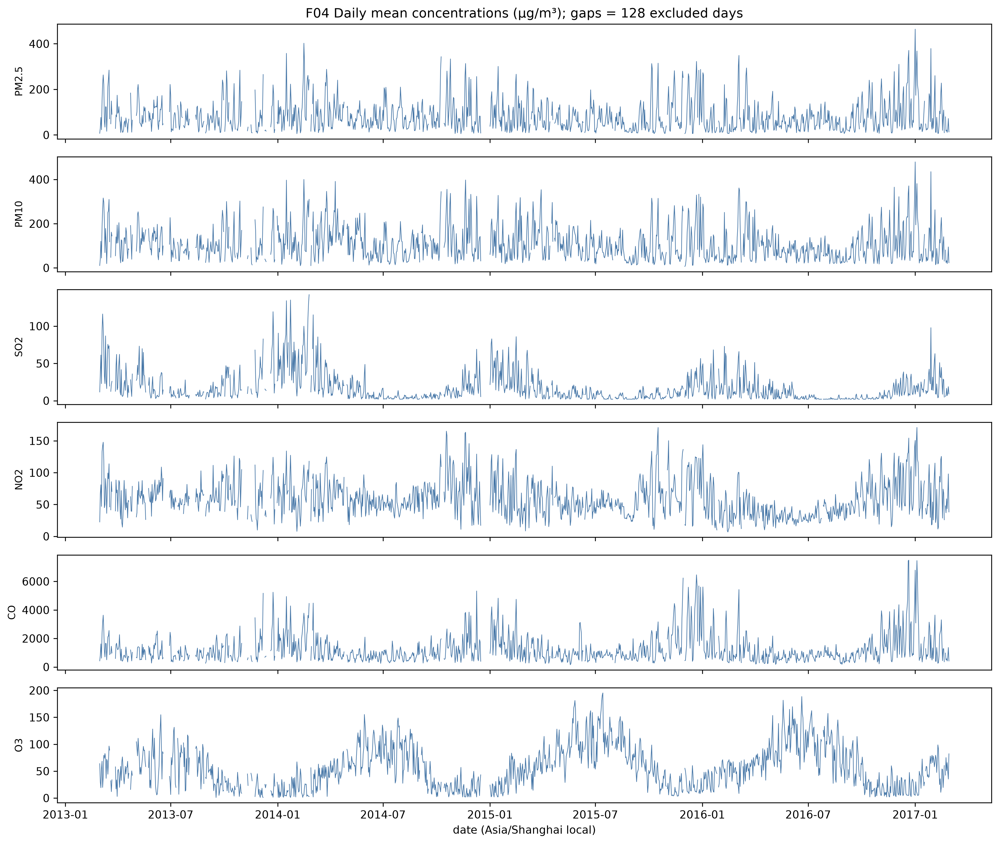

## 5. Candidate results (all 89 retained)

K-Means medians over 10 seeds:

| k | silhouette | davies_bouldin | calinski_harabasz |
| --- | --- | --- | --- |
| 2.000 | 0.361 | 1.047 | 1051.979 |
| 3.000 | 0.294 | 1.149 | 948.616 |
| 4.000 | 0.242 | 1.322 | 786.398 |
| 5.000 | 0.240 | 1.344 | 714.355 |
| 6.000 | 0.228 | 1.378 | 646.783 |
| 7.000 | 0.213 | 1.359 | 597.143 |
| 8.000 | 0.198 | 1.423 | 553.195 |

Seed agreement (45 pairwise ARIs per k):

| k | median_ari | q1_ari | q3_ari | min_ari |
| --- | --- | --- | --- | --- |
| 2.000 | 1.000 | 1.000 | 1.000 | 1.000 |
| 3.000 | 1.000 | 0.998 | 1.000 | 0.998 |
| 4.000 | 0.998 | 0.995 | 0.998 | 0.991 |
| 5.000 | 0.967 | 0.939 | 0.986 | 0.926 |
| 6.000 | 0.962 | 0.947 | 0.974 | 0.908 |
| 7.000 | 0.966 | 0.956 | 0.973 | 0.940 |
| 8.000 | 0.843 | 0.798 | 0.886 | 0.524 |

Ward cuts of the single tree:

| k | silhouette | davies_bouldin | calinski_harabasz | min_cluster_size |
| --- | --- | --- | --- | --- |
| 2.000 | 0.358 | 1.050 | 1031.880 | 510.000 |
| 3.000 | 0.246 | 1.223 | 764.265 | 206.000 |
| 4.000 | 0.198 | 1.351 | 670.456 | 206.000 |
| 5.000 | 0.190 | 1.546 | 597.890 | 206.000 |
| 6.000 | 0.187 | 1.544 | 529.126 | 105.000 |
| 7.000 | 0.171 | 1.442 | 485.765 | 100.000 |
| 8.000 | 0.164 | 1.403 | 456.460 | 75.000 |

DBSCAN outcomes (noise fraction and n_scored always shown):

| experiment_id | min_samples | eps | n_clusters | noise_fraction | n_scored | silhouette | status |
| --- | --- | --- | --- | --- | --- | --- | --- |
| E03_m5_q70 | 5.000 | 0.736 | 3 | 0.142 | 1144 | 0.100 | ok |
| E03_m5_q80 | 5.000 | 0.801 | 1 | 0.088 | 1216 | null | ok |
| E03_m5_q90 | 5.000 | 0.920 | 1 | 0.043 | 1276 | null | ok |
| E03_m5_q95 | 5.000 | 1.023 | 1 | 0.017 | 1311 | null | ok |
| E03_m10_q70 | 10.000 | 0.873 | 1 | 0.091 | 1212 | null | ok |
| E03_m10_q80 | 10.000 | 0.939 | 1 | 0.059 | 1254 | null | ok |
| E03_m10_q90 | 10.000 | 1.064 | 1 | 0.025 | 1300 | null | ok |
| E03_m10_q95 | 10.000 | 1.203 | 1 | 0.010 | 1320 | null | ok |
| E03_m20_q70 | 20.000 | 1.039 | 1 | 0.065 | 1247 | null | ok |
| E03_m20_q80 | 20.000 | 1.114 | 1 | 0.037 | 1284 | null | ok |
| E03_m20_q90 | 20.000 | 1.265 | 1 | 0.014 | 1314 | null | ok |
| E03_m20_q95 | 20.000 | 1.426 | 1 | 0.004 | 1328 | null | ok |

11 of 12 DBSCAN settings produce a single non-noise cluster; only 1 setting(s) yield ≥2 clusters. This is evidence about the density assumption, not a failure to be hidden: the six-dimensional log-standardised days form a gradient with a dense core rather than well-separated density clusters.

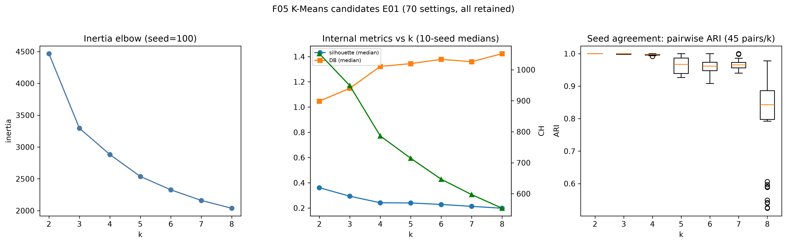
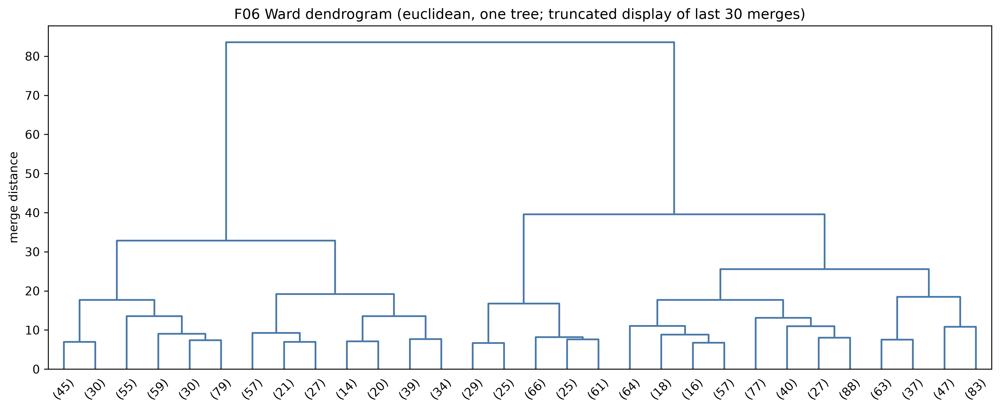
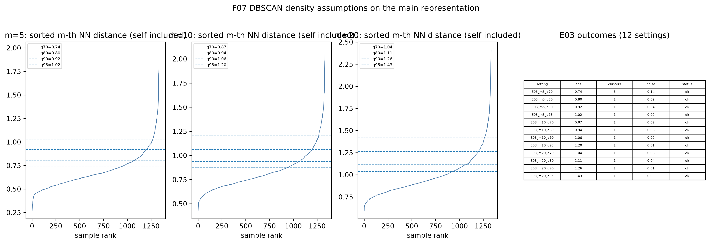

## 6. Representative selection and stability

Shortlists and stability (20 block resamples each; failed repetitions counted, never masked):

| algorithm | k | valid_repetitions | failed_repetitions | median_ari | q1_ari | q3_ari |
| --- | --- | --- | --- | --- | --- | --- |
| kmeans | 2 | 20 | 0 | 0.970 | 0.922 | 0.990 |
| ward | 2 | 20 | 0 | 0.707 | 0.554 | 0.799 |

Selection outcome: K-Means representative k=2 (median block ARI 0.970); Ward representative k=2 (median ARI 0.707). DBSCAN representative: none — no_setting_meets_two_clusters_min_size_coverage_and_valid_metrics. The full rule chain, exclusions and per-repetition ARIs are in `selection.json` and `stability/`.

## 7. What the clusters mean (original units)

Profiles are medians/IQRs of raw daily concentrations grouped by the actual labels; display numbers are ordered by PM2.5 median and mapped in `artifacts/display_mapping.json`.

### K-Means (k=2)

- **Display C1** (original label 0, n=812 days): PM2.5 median 39.0 µg/m³ (IQR 21.8–62.1), O3 median 66.0 µg/m³. above 1.2× its own all-day median: O3 (1.34×); below 0.8×: PM2.5 (0.55×), PM10 (0.61×), SO2 (0.43×), NO2 (0.75×), CO (0.63×).
- **Display C2** (original label 1, n=521 days): PM2.5 median 119.5 µg/m³ (IQR 84.6–171.6), O3 median 22.8 µg/m³. above 1.2× its own all-day median: PM2.5 (1.70×), PM10 (1.61×), SO2 (1.89×), NO2 (1.38×), CO (1.57×); below 0.8×: O3 (0.46×).

### Ward (k=2)

- **Display C1** (original label 0, n=823 days): PM2.5 median 39.8 µg/m³ (IQR 21.9–64.6), O3 median 66.6 µg/m³. above 1.2× its own all-day median: O3 (1.35×); below 0.8×: PM2.5 (0.57×), PM10 (0.62×), SO2 (0.43×), NO2 (0.76×), CO (0.63×).
- **Display C2** (original label 1, n=510 days): PM2.5 median 118.3 µg/m³ (IQR 82.7–172.5), O3 median 21.5 µg/m³. above 1.2× its own all-day median: PM2.5 (1.69×), PM10 (1.61×), SO2 (1.92×), NO2 (1.39×), CO (1.59×); below 0.8×: O3 (0.44×).

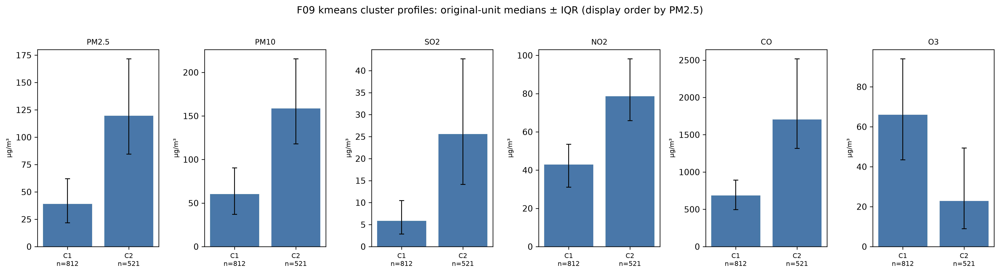

### 7.1 Within-cluster spread comes before any background story

Protocol §8 requires comparing the dispersion *inside* a cluster before invoking season or weather. IQR/median is scale-free, so it is comparable across pollutants (original units, K-Means representative):

| cluster | pollutant | n_days | median | iqr | iqr_over_median |
| --- | --- | --- | --- | --- | --- |
| 0 | PM2.5 | 812 | 39.000 | 40.354 | 1.035 |
| 0 | PM10 | 812 | 60.271 | 53.250 | 0.884 |
| 0 | SO2 | 812 | 5.833 | 7.594 | 1.302 |
| 0 | NO2 | 812 | 42.938 | 22.438 | 0.523 |
| 0 | CO | 812 | 686.890 | 397.011 | 0.578 |
| 0 | O3 | 812 | 65.981 | 50.573 | 0.766 |
| 1 | PM2.5 | 521 | 119.542 | 87.000 | 0.728 |
| 1 | PM10 | 521 | 158.500 | 97.583 | 0.616 |
| 1 | SO2 | 521 | 25.583 | 28.542 | 1.116 |
| 1 | NO2 | 521 | 78.667 | 32.292 | 0.410 |
| 1 | CO | 521 | 1704.409 | 1200.000 | 0.704 |
| 1 | O3 | 521 | 22.826 | 40.431 | 1.771 |

### 7.2 Which pollutants actually separate the clusters, and which overlap

Shared IQR span between the two clusters, in original units and as a fraction of the pooled IQR span (K-Means):

| pollutant | iqr_overlap_width | overlap_fraction_of_pooled_iqr | median_ratio_b_over_a |
| --- | --- | --- | --- |
| PM2.5 | 0.000 | 0.000 | 3.065 |
| PM10 | 0.000 | 0.000 | 2.630 |
| SO2 | 0.000 | 0.000 | 4.386 |
| NO2 | 0.000 | 0.000 | 1.832 |
| CO | 0.000 | 0.000 | 2.481 |
| O3 | 5.942 | 0.070 | 0.346 |

The full distributions (not just medians) make the same point:

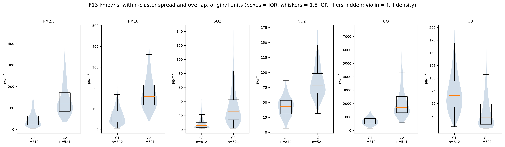
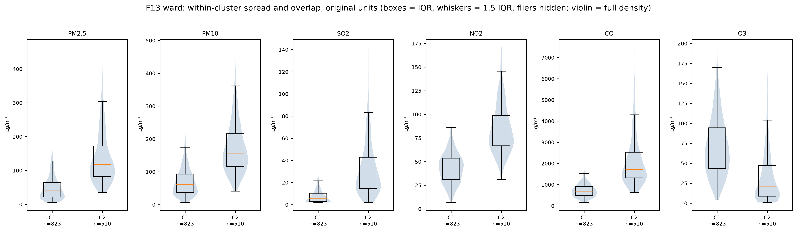

## 8. Method agreement and disagreement

Representative partitions: ARI=0.892; contingency (rows K-Means, columns Ward):

| kmeans | 0 | 1 |
| --- | --- | --- |
| 0 | 799 | 13 |
| 1 | 24 | 497 |

Same-k ARI separates algorithm geometry from cluster-count effects:

| k | ari_kmeans_seed100_vs_ward |
| --- | --- |
| 2.000 | 0.892 |
| 3.000 | 0.391 |
| 4.000 | 0.634 |
| 5.000 | 0.589 |
| 6.000 | 0.522 |
| 7.000 | 0.416 |
| 8.000 | 0.359 |

The shared PCA projection (display only; PC1+PC2 explain 82.0% of variance) shows how the same dates are organised by each method:

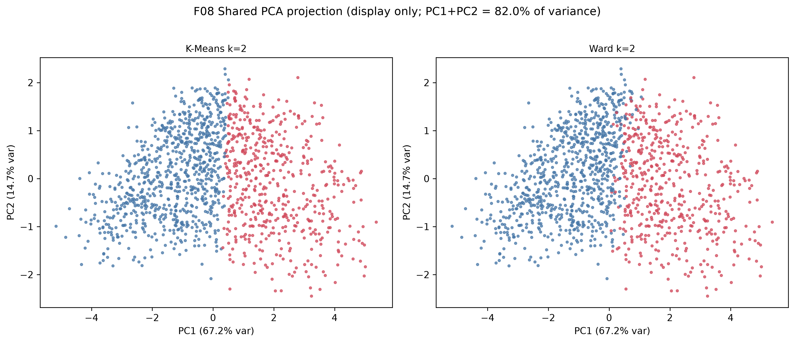
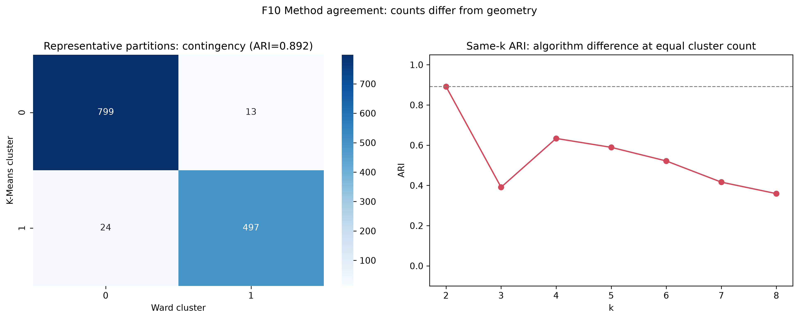

### 8.1 Case study of the largest split/merge cell (fixed selection rule)

Rule: largest off-diagonal contingency cell, then earliest dates. Selected cell: K-Means cluster 1 × Ward cluster 0, containing **24 days**.

- K-Means cluster 1 holds 521 days in total; Ward cluster 0 holds 823.
- Intersection 24 days; K-Means-only 497 days; Ward-only 799 days.

Earliest five dates in that cell, in original units (µg/m³):

| date | PM2.5 | PM10 | SO2 | NO2 | CO | O3 |
| --- | --- | --- | --- | --- | --- | --- |
| 2013-04-01 | 94.9 | 112.6 | 17.1 | 39.1 | 1208.2 | 51.0 |
| 2013-06-05 | 122.8 | 118.0 | 3.0 | 55.5 | 1537.3 | 22.2 |
| 2013-07-18 | 145.7 | 131.3 | 16.5 | 53.6 | 1429.2 | 75.9 |
| 2013-08-15 | 121.3 | 138.8 | 8.6 | 61.4 | 1060.9 | 91.6 |
| 2013-09-13 | 83.8 | 101.3 | 3.9 | 63.7 | 1070.8 | 13.6 |

Their medians: PM2.5 121.3, PM10 118.0, SO2 8.6, NO2 55.5, CO 1208.2, O3 51.0.

## 9. Background context (after frozen selection)

Eligible-day coverage by season — the denominator that must accompany every seasonal percentage (2013 and 2017 are partial calendar years):

| season | calendar_days | eligible_days | coverage_fraction |
| --- | --- | --- | --- |
| autumn | 364 | 333 | 0.915 |
| spring | 368 | 339 | 0.921 |
| summer | 368 | 336 | 0.913 |
| winter | 361 | 325 | 0.900 |

Year composition, P(cluster | year), denominator = eligible days in that year:

| year | algorithm | n_cluster_0 | n_cluster_1 | eligible_days_in_year | pct_cluster_0 | pct_cluster_1 |
| --- | --- | --- | --- | --- | --- | --- |
| 2013 | kmeans | 126 | 108 | 234 | 0.538 | 0.462 |
| 2014 | kmeans | 182 | 153 | 335 | 0.543 | 0.457 |
| 2015 | kmeans | 214 | 137 | 351 | 0.610 | 0.390 |
| 2016 | kmeans | 260 | 96 | 356 | 0.730 | 0.270 |
| 2017 | kmeans | 30 | 27 | 57 | 0.526 | 0.474 |

Season composition within each K-Means cluster (denominator = cluster days):

| cluster | spring | summer | autumn | winter |
| --- | --- | --- | --- | --- |
| 0.000 | 0.234 | 0.373 | 0.224 | 0.169 |
| 1.000 | 0.286 | 0.063 | 0.290 | 0.361 |

The same composition for the Ward representative (denominator = Ward cluster days):

| cluster | spring | summer | autumn | winter |
| --- | --- | --- | --- | --- |
| 0.000 | 0.235 | 0.378 | 0.222 | 0.165 |
| 1.000 | 0.286 | 0.049 | 0.294 | 0.371 |

The reverse direction — within each season, the fraction of days assigned to each K-Means cluster (denominator = season days) — is reported as well, so neither direction is read as the other:

| cluster | spring | summer | autumn | winter |
| --- | --- | --- | --- | --- |
| 0.000 | 0.560 | 0.902 | 0.547 | 0.422 |
| 1.000 | 0.440 | 0.098 | 0.453 | 0.578 |

Weather medians by cluster (descriptive; valid-day denominators in `weather_profiles.csv`):

| cluster | DEWP_mean | PRES_mean | RAIN_sum | TEMP_mean | WSPM_mean |
| --- | --- | --- | --- | --- | --- |
| 0.000 | 8.700 | 1007.959 | 0.000 | 20.502 | 1.725 |
| 1.000 | -0.938 | 1014.329 | 0.000 | 6.737 | 1.283 |

These associations are descriptive. Clusters are not pollution sources, not causal effects of weather, and not official air-quality health grades. No significance tests are run on the six clustering features themselves (that would circularly "validate" the discovery).

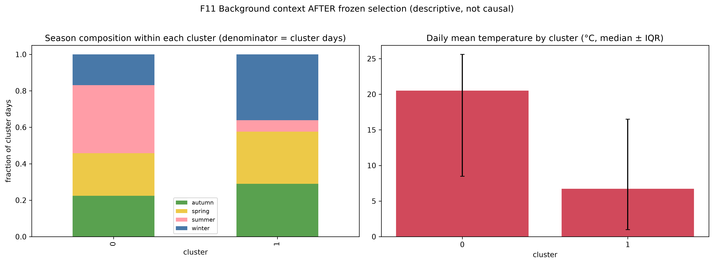

## 10. Sensitivity and robustness

Raw+StandardScaler at the frozen k, compared with the main representation:

| algorithm | k | ari_vs_main |
| --- | --- | --- |
| kmeans | 2 | 0.392 |
| ward | 2 | 0.719 |

ARI alone is not enough: the protocol also requires the **original-unit profile change**. Median shift of each cluster under raw+StandardScaler relative to the main representation (K-Means):

| cluster | pollutant | median_main | median_raw | median_ratio_raw_over_main |
| --- | --- | --- | --- | --- |
| 0 | PM2.5 | 39.000 | 49.438 | 1.268 |
| 0 | PM10 | 60.271 | 74.354 | 1.234 |
| 0 | SO2 | 5.833 | 7.500 | 1.286 |
| 0 | NO2 | 42.938 | 48.167 | 1.122 |
| 0 | CO | 686.890 | 800.000 | 1.165 |
| 0 | O3 | 65.981 | 59.167 | 0.897 |
| 1 | PM2.5 | 119.542 | 161.667 | 1.352 |
| 1 | PM10 | 158.500 | 200.167 | 1.263 |
| 1 | SO2 | 25.583 | 38.250 | 1.495 |
| 1 | NO2 | 78.667 | 97.125 | 1.235 |
| 1 | CO | 1704.409 | 2416.667 | 1.418 |
| 1 | O3 | 22.826 | 12.708 | 0.557 |

Block stability and transformation sensitivity together:

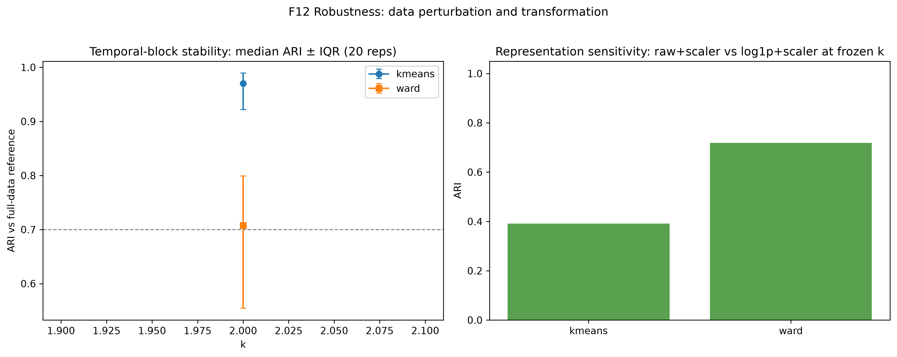

## 11. Limitations

1. Eligible-day selection bias: missing hours are temporally structured; excluded days are not random.
2. Correlated pollutants double-weight shared information in euclidean distance.
3. Internal metrics favour compact spherical clusters; DBSCAN's degeneration shows the geometry dependence.
4. Stability resamples were used for selection → exploratory bias; ARI values are not confidence intervals.
5. Single station, single city, 2013–2017; no claim of generalisation to other periods or sites.
6. Observational groupings only; no causal, source-apportionment or health-grade interpretation.

## 12. Conclusion

On the same 1333 days and the same transformed space, K-Means and Ward produce broadly consistent low-vs-high pollution organisation at their representative k (ARI=0.892) but differ in how intermediate days are split (same-k ARI as low as 0.359). DBSCAN's near-universal single-cluster outcome characterises the data as a continuous gradient with a dense core. The discovered day types are reproducible under temporal-block perturbation (median ARI ≥ 0.707). Robustness to the representation is method-dependent: Ward's partition is moderately stable under the raw-value branch (ARI=0.719) whereas K-Means reorganises substantially (ARI=0.392), so the log1p choice is an explicit, disclosed modelling decision rather than a neutral default. Together these results support using the clusters as descriptive knowledge rather than predictive or causal claims.

## References

- UCI Machine Learning Repository (2017). Beijing Multi-Site Air-Quality Data Set, ID 501. https://archive.ics.uci.edu/dataset/501/beijing+multi+site+air+quality+data
- Zhang, S., Guo, B., Dong, A., He, J., Xu, Z., Chen, S.X. (2016). Cautionary tales on air-quality improvement in Beijing. *Proc. R. Soc. A* 472: 20160457. (Dataset companion paper as cited by UCI.)
- Course materials: AISC5030 Week 5 slides/notebooks (method definitions and Topic 3 brief).

## Appendix A. Reproducibility

Run `20261124T223107Z-0c5c7f9d`; config snapshot and SHA256 of data, config and executed source in `manifest.json`; environment in `requirements-lock.txt`. Re-run: `python scripts/run_project.py --stage all`; notebooks 01–03 execute top-to-bottom via `scripts/run_notebooks.py`. All 89 candidate label files carry date keys; figures F01–F12 in `figures/`.
